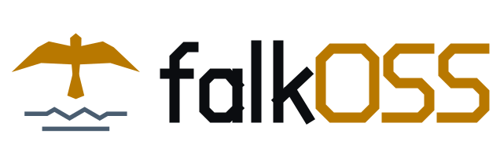

<p align="center">
  <picture>
    <source media="(prefers-color-scheme: dark)" srcset="assets/falkoss-lockup-on-dark.svg">
    
  </picture>
</p>

<p align="center"><b>Free software from Falkensee.</b><br>
<sub>Falcon Lake Open Source Software</sub></p>

**falkOSS** builds and maintains open-source software for people who build things: open code under open licences,
developed in public, everything included, no telemetry. A non-profit (gUG, in formation) from Falkensee, the town next to Berlin.

### Projects

| Project | What | Status |
|---|---|---|
| [omaflake](https://github.com/omaflake) | clean, disposable NixOS and macOS VMs on Apple silicon | in development |

Each project keeps its own organisation, name and design; falkOSS is the home behind them.

### Principles

- **Free licences** – everything we publish is open source under an OSI-approved licence.
- **Everything included** – the free version is the whole product: one edition, every feature, for everyone. We
  charge for work – hosting, support, development, teaching – never for unlocking.
- **No telemetry** – our software does not phone home.
- **In the open** – issues, plans, reviews and decisions happen in public.
- **Non-profit** – money goes into the software, never into profits.

### The name

```
FAlcon LaKe   → FALK
FALKensee     → FALK
FALK + OSS    → falkOSS
Falcon Lake Open Source Software = FLOSS
```

*Falke* is German for falcon, *See* for lake.

### Contribute

Code, docs, translations – every project has its contributing guide. Open an issue or a discussion in the project
you care about.
